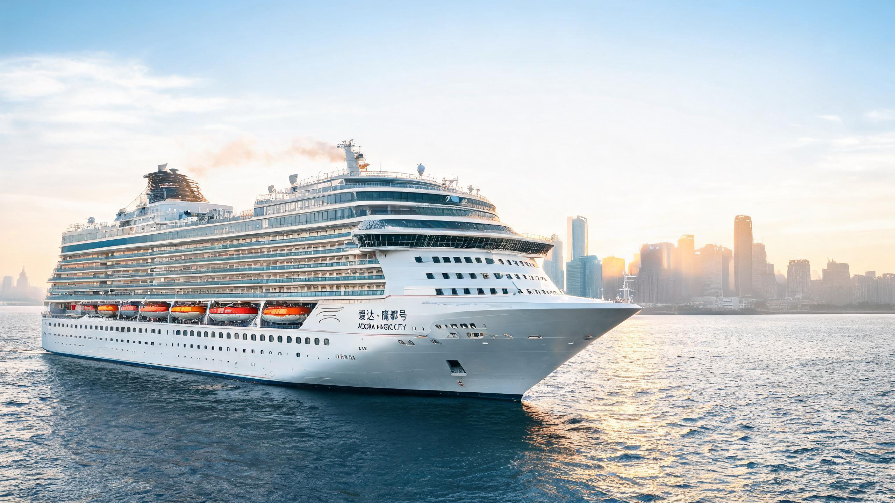

# 任务三 · 综合创作 + 技术答辩：与 AI 的关键对话记录

> 超纲加分项：① 光影展新增第六件展品「爱达·魔都号」（首艘国产大型邮轮，2024 年 1 月首航，AI 生成 16:9 图片）；② 增加课堂上没讲过的 Swiper 能力——本任务选用 **keyboard 键盘控制**。
> 页面：`swiper-task3.html`（基于 `swiper-task.html` 修改）。

---

## 第 1 轮提示词

> 我有一个 Swiper 轮播页面（Swiper 11），想加键盘控制翻页，另外帮我加一张新展品图片（爱达·魔都号，首艘国产大型邮轮，2024年1月首航）。轮播容器 id 是 wySw1，直接给我代码。

### AI 第 1 轮回答（模拟 AI 的典型缺陷回答）

```javascript
var wyswiper = new Swiper("#wySw1", {
  keyboard: {
    enabled: true,
    onlyInViewPort: true   // ← 注意这里
  }
});
```

```html
<div class="swiper-slide">
  
  <h3>爱达·魔都号</h3>
</div>
```

### 发现的问题（对照任务要求逐条核对）

| # | 问题 | 分析 |
|---|------|------|
| 1 | 参数名写错：`onlyInViewPort`（V 大写） | Swiper 官方参数是**小写驼峰 `onlyInViewport`**。参数名错了不报错但不生效，属于最难排查的一类 bug |
| 2 | 图片用了外链 URL | 页面要求展品图本地可用且由 AI 生成；外链断网就挂，应放到 `swiper-imgs/adora_1.jpg` |
| 3 | slide 结构不完整 | 光影展每张 slide 是 `img + .wy-cap（h3 标题 + p 说明）` 三层结构，AI 只给了 img + h3，缺说明文字和层级 |
| 4 | 没说明按键行为 | 没讲支持哪些键、什么条件下响应——答辩时说不清参数作用 |

---

## 第 2 轮提示词（修正版）

> 三处修正：① 参数名以 Swiper 11 官方文档为准，是 onlyInViewport（v 小写）；② 图片改为本地相对路径 swiper-imgs/adora_1.jpg（AI 生成，横版 16:9）；③ slide 按光影展现有结构补全：img + div.wy-cap（内含 h3 标题 + p 一句说明）。另外请说明 keyboard 支持哪些按键、enabled 和 onlyInViewport 各控制什么。

### AI 第 2 轮回答（最终采用版）

```javascript
var wyswiper = new Swiper("#wySw1", {
  keyboard: {
    enabled: true,         // 开启键盘控制：← / → 方向键翻页
    onlyInViewport: true   // 仅当轮播在可视区域内时才响应按键
  }
});
```

```html
<div class="swiper-slide">
  
  <div class="wy-cap">
    <h3>爱达·魔都号</h3>
    <p>首艘国产大型邮轮 · 2024 年 1 月首航（AI 生成展品图）</p>
  </div>
</div>
```

**补充说明（AI 第 2 轮给出）**：keyboard 模块支持 ← / → / ↑ / ↓ 方向键与 PageUp / PageDown；`enabled` 是总开关；`onlyInViewport: true` 防止页面滚动到别处时按键误触发轮播。已应用到 `swiper-task3.html` 的演示一 #wySw1，第六件展品 slide 已加入全部 4 个演示台。

---

## 答辩四连问（预备答案）

**① 这段代码什么意思？**
给 #wySw1 这个轮播实例挂上 Swiper 的 keyboard 模块：`enabled: true` 打开键盘监听，用户按 ← / →（或 ↑ / ↓、PageUp / PageDown）时触发翻页；`onlyInViewport: true` 加了安全限制——只有当轮播出现在浏览器可视区域内，按键才会被它响应。

**② AI 第一次给的哪里不对、你改了什么？**
三处：参数名 `onlyInViewPort` 大小写写错（官方是小写 v，写错不报错但不生效）；图片用外链（断网失效，改成 AI 生成本地图 swiper-imgs/adora_1.jpg）；slide 结构缺 `.wy-cap` 说明层（对照页面现有三层结构补全）。

**③ 新参数的作用？**
`keyboard.enabled`：键盘控制总开关；`keyboard.onlyInViewport`：视口内才响应（页面有多个轮播/长页面时防止误触）；另外 Swiper 11 中 `keyboard: true` 是 `{ enabled: true }` 的简写。

**④ 现场把 delay 改成指定值并解释预期变化**
（答辩现场演示：把任务三页面中任一 autoplay 的 delay 改小/改大）
- 改 `autoplay: { delay: 1300 }` → 预期：轮播每 **1.3 秒**翻一页，明显变快；
- 改 `delay: 5000` → 每 5 秒翻一页，明显变慢；
- delay 单位是毫秒，改完保存刷新立即生效；若 `disableOnInteraction: false` 在，手动拖动后仍按新间隔续播。

---

## 人工验证清单

| # | 验证项 | 方法 | 截图 | 一句话结论 |
|---|--------|------|------|-----------|
| 1 | 第六件展品 | 翻到光影展最后一张，出现「爱达·魔都号」邮轮图（4 个演示台都有） | （贴图） | ＿＿＿＿＿＿ |
| 2 | 键盘控制 | 鼠标点击演示一轮播区域 → 按 → / ← 键能翻页 | （贴图） | ＿＿＿＿＿＿ |
| 3 | 视口限制 | 页面滚到顶部（轮播不可见）按方向键，页面滚动/无翻页反应 | （贴图） | ＿＿＿＿＿＿ |
| 4 | 图片 16:9 | F12 查看 adora_1.jpg 尺寸为 16:9 横版 | （贴图） | ＿＿＿＿＿＿ |
